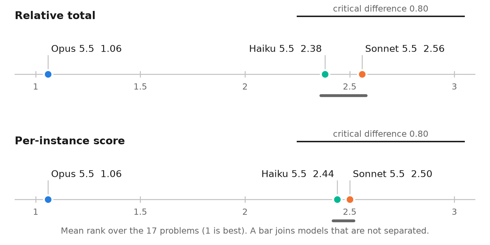
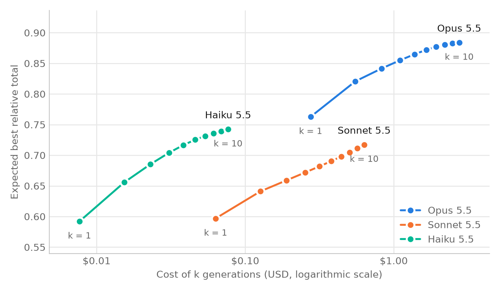

# Results

The analysis of section 9 of [PROTOCOL.md](../PROTOCOL.md). This file is written by `analysis/analyze.py`; the tables are also in `analysis/tables/` as CSV files.

The data are 510 programs (17 problems, 3 models, 10 generations) and 2280 run records.

## Question 1: quality

The relative total is the total of a program divided by the best team total of the round. Each cell gives the median over the 10 generations, then the worst and the best in brackets. The last column is the best open-source total of [google-hashcode-solvers](https://github.com/uran-lajci/google-hashcode-solvers) (commit `781e0a0`) on the same scale; it was measured with a 10-minute limit and without the example instance.

| Problem | Opus 5.5 | Sonnet 5.5 | Haiku 5.5 | Open source |
|---|---:|---:|---:|---:|
| Street View Routing | 0.979 (0.184 to 0.987) | 0.982 (0.924 to 0.991) | 0.525 (0.462 to 0.990) | 1.003 |
| Optimize a Data Center | 0.988 (0.980 to 0.995) | 0.867 (0.000 to 0.894) | 0.908 (0.796 to 0.953) | 0.983 |
| Loon | 0.648 (0.493 to 0.979) | 0.103 (0.039 to 0.726) | 0.082 (0.000 to 0.347) | 0.975 |
| Delivery | 0.969 (0.950 to 0.988) | 0.946 (0.931 to 0.958) | 0.811 (0.000 to 0.942) |  |
| Satellites | 0.448 (0.000 to 0.898) | 0.221 (0.000 to 0.474) | 0.221 (0.000 to 0.919) | 0.244 |
| Streaming Videos | 0.997 (0.000 to 0.998) | 0.995 (0.995 to 0.995) | 0.995 (0.889 to 0.995) |  |
| Router Placement | 0.984 (0.850 to 0.990) | 0.850 (0.774 to 0.851) | 0.851 (0.110 to 0.989) | 0.990 |
| Self-driving Rides | 0.971 (0.950 to 0.982) | 0.950 (0.950 to 0.950) | 0.950 (0.945 to 0.950) |  |
| City Plan | 0.958 (0.116 to 1.052) | 0.079 (0.000 to 0.282) | 0.249 (0.001 to 0.430) | 0.870 |
| Photo Slideshow | 0.829 (0.795 to 0.839) | 0.718 (0.684 to 0.743) | 0.694 (0.536 to 0.746) |  |
| Compiling Google | 0.514 (0.371 to 0.605) | 0.365 (0.294 to 0.461) | 0.370 (0.212 to 0.469) | 0.983 |
| Book Scanning | 0.990 (0.990 to 0.992) | 0.988 (0.195 to 0.988) | 0.988 (0.988 to 0.988) |  |
| Assembling Smartphones | 0.320 (0.008 to 0.688) | 0.053 (0.013 to 0.415) | 0.179 (0.030 to 0.399) | 1.012 |
| Traffic Signaling | 0.950 (0.873 to 0.978) | 0.850 (0.295 to 0.854) | 0.882 (0.690 to 0.906) |  |
| Software Engineering at Scale | 0.735 (0.727 to 0.739) | 0.732 (0.569 to 0.733) | 0.733 (0.575 to 0.735) | 0.848 |
| Mentorship and Teamwork | 0.599 (0.351 to 0.836) | 0.530 (0.281 to 0.779) | 0.475 (0.311 to 0.693) | 1.714 |
| Santa Tracker | 0.343 (0.000 to 0.482) | 0.013 (0.013 to 0.099) | 0.033 (0.000 to 0.169) | 0.897 |
| **Median over the problems** | **0.950** | **0.732** | **0.694** |  |

The rank is the position the total would take among the teams of the round. Each cell gives the median rank over the 10 generations, then the best and the worst in brackets.

| Problem | Teams | Opus 5.5 | Sonnet 5.5 | Haiku 5.5 |
|---|---:|---:|---:|---:|
| Street View Routing | 54 | 7 (6 to 53) | 6 (4 to 11) | 49 (5 to 50) |
| Optimize a Data Center | 230 | 2 (2 to 7) | 76 (59 to 231) | 51.5 (18 to 101) |
| Loon | 65 | 9 (6 to 19) | 65.5 (9 to 66) | 66 (46 to 66) |
| Delivery | 1,050 | 25.5 (2 to 55) | 67 (47 to 108) | 255.5 (78 to 955) |
| Satellites | 51 | 19 (11 to 48) | 30 (19 to 48) | 30 (8 to 48) |
| Streaming Videos | 2,815 | 8 (5 to 2,779) | 21 (21 to 24) | 22 (21 to 227) |
| Router Placement | 50 | 38 (28 to 48) | 48 (48 to 48) | 48 (31 to 50) |
| Self-driving Rides | 3,012 | 323 (222 to 473) | 476 (476 to 477) | 476 (476 to 522) |
| City Plan | 40 | 7 (1 to 40) | 40 (37 to 41) | 38 (34 to 41) |
| Photo Slideshow | 6,672 | 143 (120 to 228) | 387 (337 to 483) | 449 (330 to 1,023) |
| Compiling Google | 41 | 35 (33 to 38) | 38.5 (38 to 39) | 38 (38 to 40) |
| Book Scanning | 10,725 | 194 (113 to 206) | 352 (351 to 7,553) | 351 (351 to 352) |
| Assembling Smartphones | 45 | 28 (8 to 46) | 46 (23 to 46) | 38 (26 to 46) |
| Traffic Signaling | 9,003 | 26 (12 to 1,764) | 2,265 (2,207 to 5,860) | 1,567 (139 to 5,167) |
| Software Engineering at Scale | 38 | 21.5 (20 to 29) | 25 (25 to 36) | 25 (21 to 36) |
| Mentorship and Teamwork | 10,177 | 904.5 (47 to 3,256) | 1,485.5 (130 to 3,386) | 1,933.5 (399 to 3,319) |
| Santa Tracker | 39 | 21 (12 to 40) | 39 (34 to 39) | 38 (34 to 40) |

## Question 2: spread

For the relative total over the 10 generations: the interquartile range (IQR), the range, and the number of generations with a valid output on every instance.

| Problem | IQR, Opus 5.5 | IQR, Sonnet 5.5 | IQR, Haiku 5.5 | Range, Opus 5.5 | Range, Sonnet 5.5 | Range, Haiku 5.5 | Valid, Opus 5.5 | Valid, Sonnet 5.5 | Valid, Haiku 5.5 |
|---|---:|---:|---:|---:|---:|---:|---:|---:|---:|
| Street View Routing | 0.009 | 0.005 | 0.497 | 0.802 | 0.066 | 0.528 | 10 | 10 | 10 |
| Optimize a Data Center | 0.006 | 0.026 | 0.044 | 0.015 | 0.894 | 0.157 | 10 | 10 | 10 |
| Loon | 0.302 | 0.088 | 0.081 | 0.486 | 0.687 | 0.347 | 10 | 10 | 9 |
| Delivery | 0.003 | 0.010 | 0.110 | 0.038 | 0.027 | 0.942 | 10 | 10 | 9 |
| Satellites | 0.036 | 0.180 | 0.725 | 0.898 | 0.474 | 0.919 | 9 | 9 | 8 |
| Streaming Videos | 0.002 | 0.000 | 0.000 | 0.998 | 0.000 | 0.106 | 9 | 10 | 10 |
| Router Placement | 0.117 | 0.005 | 0.070 | 0.140 | 0.077 | 0.879 | 10 | 10 | 10 |
| Self-driving Rides | 0.011 | 0.000 | 0.000 | 0.032 | 0.000 | 0.005 | 10 | 10 | 10 |
| City Plan | 0.108 | 0.175 | 0.069 | 0.936 | 0.282 | 0.430 | 10 | 8 | 10 |
| Photo Slideshow | 0.028 | 0.037 | 0.067 | 0.043 | 0.059 | 0.210 | 10 | 10 | 10 |
| Compiling Google | 0.054 | 0.066 | 0.133 | 0.233 | 0.167 | 0.257 | 10 | 10 | 9 |
| Book Scanning | 0.000 | 0.000 | 0.000 | 0.002 | 0.793 | 0.000 | 10 | 9 | 10 |
| Assembling Smartphones | 0.185 | 0.175 | 0.136 | 0.680 | 0.401 | 0.370 | 9 | 6 | 7 |
| Traffic Signaling | 0.080 | 0.003 | 0.157 | 0.105 | 0.560 | 0.216 | 10 | 5 | 10 |
| Software Engineering at Scale | 0.001 | 0.000 | 0.001 | 0.012 | 0.163 | 0.161 | 10 | 10 | 10 |
| Mentorship and Teamwork | 0.247 | 0.341 | 0.226 | 0.484 | 0.498 | 0.381 | 10 | 10 | 10 |
| Santa Tracker | 0.069 | 0.000 | 0.054 | 0.482 | 0.087 | 0.169 | 9 | 10 | 10 |
| **Median over the problems** | **0.036** | **0.010** | **0.070** | **0.233** | **0.167** | **0.257** | **10** | **10** | **10** |

## Question 3: models

### Friedman and Nemenyi tests

Each model has 17 paired observations: its median over the 10 generations on each problem. Rank 1 is the best model on a problem. The p-value comes from the chi-square distribution with 2 degrees of freedom. The Nemenyi test at the 5% level separates two models whose mean ranks differ by more than 0.804.

| Measure | Mean rank, Opus 5.5 | Mean rank, Sonnet 5.5 | Mean rank, Haiku 5.5 | Friedman statistic | p-value | Pairs separated |
|---|---:|---:|---:|---:|---:|---:|
| Relative total | 1.059 | 2.559 | 2.382 | 23.19 | 9.2e-06 | Opus 5.5 and Sonnet 5.5; Opus 5.5 and Haiku 5.5 |
| Per-instance score | 1.059 | 2.500 | 2.441 | 22.96 | 1e-05 | Opus 5.5 and Sonnet 5.5; Opus 5.5 and Haiku 5.5 |

### Best of k

The expected best relative total among k of the 10 generations of a model, exact over all choices of k generations, averaged over the 17 problems. The cost is k times the mean cost of one generation.

| k | Opus 5.5, expected best | Sonnet 5.5, expected best | Haiku 5.5, expected best | Opus 5.5, cost (USD) | Sonnet 5.5, cost (USD) | Haiku 5.5, cost (USD) |
|---|---:|---:|---:|---:|---:|---:|
| 1 | 0.763 | 0.597 | 0.592 | 0.276 | 0.063 | 0.008 |
| 2 | 0.821 | 0.641 | 0.656 | 0.551 | 0.126 | 0.015 |
| 3 | 0.842 | 0.659 | 0.685 | 0.827 | 0.190 | 0.023 |
| 4 | 0.855 | 0.672 | 0.704 | 1.103 | 0.253 | 0.031 |
| 5 | 0.865 | 0.682 | 0.717 | 1.379 | 0.316 | 0.038 |
| 6 | 0.872 | 0.690 | 0.725 | 1.654 | 0.379 | 0.046 |
| 7 | 0.877 | 0.698 | 0.731 | 1.930 | 0.442 | 0.054 |
| 8 | 0.881 | 0.705 | 0.736 | 2.206 | 0.506 | 0.061 |
| 9 | 0.883 | 0.711 | 0.739 | 2.481 | 0.569 | 0.069 |
| 10 | 0.884 | 0.717 | 0.742 | 2.757 | 0.632 | 0.077 |

### Validity and cost

The prices are the list prices in `harness/config.py`, read on 2026-11-03. They were checked against the pricing page on 2026-11-26, the second run date, and had not changed.

|  | Opus 5.5 | Sonnet 5.5 | Haiku 5.5 |
|---|---:|---:|---:|
| Programs that compile | 167 of 170 (98.2%) | 169 of 170 (99.4%) | 169 of 170 (99.4%) |
| Valid runs | 744 of 760 (97.9%) | 731 of 760 (96.2%) | 745 of 760 (98.0%) |
| Programs valid on every instance | 166 | 157 | 162 |
| Programs with a different output when repeated | 14 | 6 | 11 |
| Input tokens per program (mean) | 16,034 | 16,034 | 16,034 |
| Output tokens per program (mean) | 10,579 | 3,114 | 12,132 |
| Of which thinking tokens (mean) | 6,822 | 981 | 9,762 |
| Programs written without thinking | 0 | 98 | 0 |
| Cost per program in USD (mean) | 0.2757 | 0.0632 | 0.0077 |
| Cost of the 170 programs in USD | 46.87 | 10.74 | 1.30 |
| Latency per program in seconds (median) | 82 | 24 | 60 |

## Sensitivity: a strict 10-second limit

Section 6 repeats the main results with every run longer than 10 seconds counted as a timeout with score 0.

|  | Opus 5.5 | Sonnet 5.5 | Haiku 5.5 |
|---|---:|---:|---:|
| Runs longer than 10 seconds | 14 | 29 | 11 |
| Of which runs that lose a score above 0 | 14 | 20 | 8 |
| Median relative total over the problems, 60-second limit | 0.950 | 0.732 | 0.694 |
| Median relative total over the problems, 10-second limit | 0.892 | 0.732 | 0.694 |
| Mean rank, 60-second limit | 1.059 | 2.559 | 2.382 |
| Mean rank, 10-second limit | 1.118 | 2.500 | 2.382 |

With the 10-second limit the Friedman statistic is 20.27 (p = 4e-05); the Nemenyi test separates: Opus 5.5 and Sonnet 5.5; Opus 5.5 and Haiku 5.5.

